# PetroViz — Руководство пользователя

> **Версия:** 2.0 · 2026-10  
> **Аудитория:** Геофизики, петрофизики, инженеры-разработчики месторождений  
> **Автор:** Васютинский Егор, Академия ТОП

---

## 📖 Содержание

1. [Введение](#1-введение)
2. [Начало работы](#2-начало-работы)
3. [Загрузка данных](#3-загрузка-данных)
4. [Работа с планшетом](#4-работа-с-планшетом)
5. [Петрофизические расчёты](#5-петрофизические-расчёты)
6. [Сохранение и загрузка расчётов](#6-сохранение-и-загрузка-расчётов)
7. [Экспорт данных](#7-экспорт-данных)
8. [Сохранение вида планшета](#8-сохранение-вида-планшета)
9. [Администрирование](#9-администрирование)
10. [Типичные сценарии](#10-типичные-сценарии)
11. [Частые вопросы и решение проблем](#11-частые-вопросы-и-решение-проблем)
12. [Приложение: формулы и параметры](#12-приложение-формулы-и-параметры)

---

## 1. Введение

### Что такое PetroViz

**PetroViz** — это облачная платформа для быстрого просмотра и петрофизической интерпретации данных каротажа скважин (файлов формата LAS). 

Наш инструмент создан для того, чтобы избавить вас от необходимости устанавливать тяжеловесные десктопные комплексы (такие как Techlog или Geolog) для рутинных задач. PetroViz позволяет работать с данными прямо в браузере с любого компьютера.

### Основные возможности

| Модуль | Описание |
|---|---|
| **Загрузка данных** | Чтение файлов LAS 1.2 и 2.0, поддержка разных кодировок и нестандартных названий кривых. |
| **Визуализация** | Построение интерактивных планшетов. Совмещение плотности и нейтрона, всех кривых сопротивления. Гибкая настройка масштабов. |
| **Петрофизика** | 14 методов расчёта: глинистость (Vshale), пористость (PHI), водонасыщенность (Sw, Swi, R0), коллектор (NTG) и проницаемость (Perm). |
| **Сравнение** | Экспресс-анализ пористости 4 методами одновременно с построением кросс-плотов и сравнением с внешними данными (например, керном). |
| **Сохранение** | Все расчёты сохраняются в базе данных. Система запоминает, на основе каких именно кривых и параметров был сделан каждый расчёт. |
| **Экспорт** | Выгрузка результатов в LAS, CSV (для Excel) и формирование векторных PDF-отчётов. |

---

## 2. Начало работы

### 2.1 Доступ к системе
Платформа работает в режиме онлайн. Вам не нужно ничего скачивать или устанавливать. 
Просто откройте браузер и перейдите по адресу: **https://petroviz.ru**

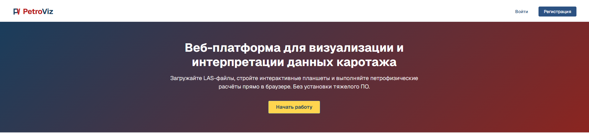

### 2.2 Регистрация
1. На главной странице нажмите кнопку **«Регистрация»**.
2. Заполните форму: укажите имя пользователя (логин), адрес электронной почты и пароль (минимум 8 символов).
3. Нажмите кнопку **«Зарегистрироваться»**.

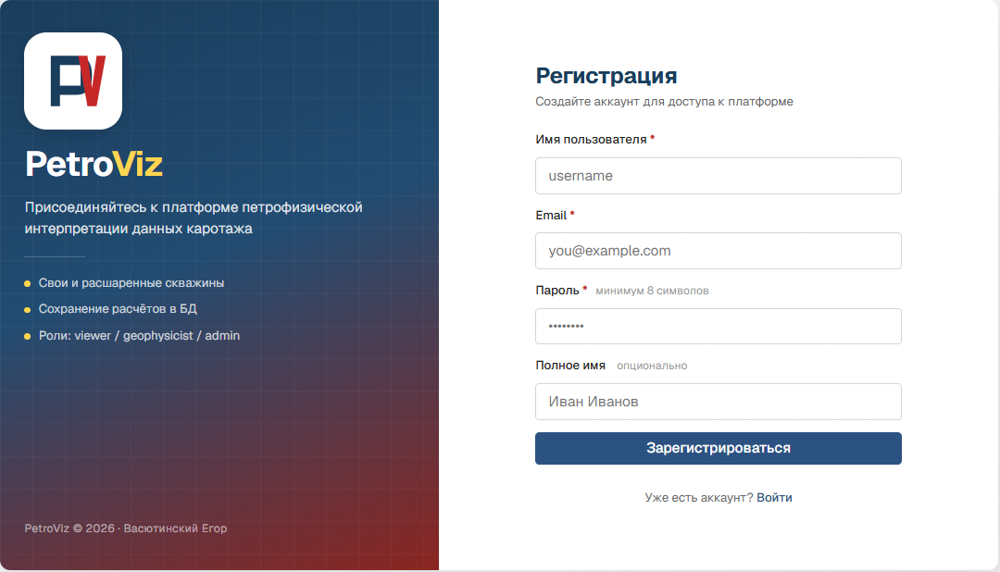

### 2.3 Вход в систему
Для входа введите ваш логин и пароль на странице авторизации.

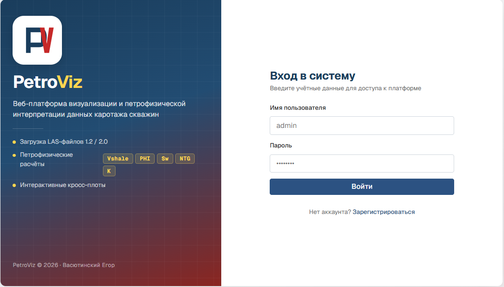

### 2.4 Роли пользователей и права доступа

| Действие | Наблюдатель | Геофизик | Администратор |
|---|---|---|---|
| Просмотр доступных скважин | ✅ | ✅ | ✅ |
| Загрузка LAS | ✅ | ✅ | ✅ |
| Запуск расчётов (предпросмотр) | ✅ | ✅ | ✅ |
| **Сохранение расчётов в БД** | ❌ | ✅ | ✅ |
| **Удаление расчётов** | ❌ | только свои | любые |
| Управление пользователями | ❌ | ❌ | ✅ |
| Выдача доступов к скважинам | ❌ | ❌ | ✅ |

> ⚠️ **Важно!** После регистрации вы получаете роль «Наблюдатель». Вы можете строить графики и «крутить» ползунки, но кнопка **«Сохранить»** будет неактивна (серого цвета). Чтобы получить возможность сохранять результаты в базу, попросите администратора платформы повысить вашу роль до **«Геофизик»** (см. раздел 9).

---

## 3. Загрузка данных

### 3.1 Поддерживаемые форматы
Платформа работает с файлами **LAS** (Log ASCII Standard) версий 1.2 и 2.0. Размер файла не должен превышать 50 МБ.

| Что платформа успешно читает | Что останется за пределами системы |
|---|---|
| Стандартные секции LAS | Форматы DLIS, SEG-Y |
| Глубины, названные как MD, TVD, DEPTH_M | Многомерные файлы LAS |
| Разные кодировки (UTF-8, CP1251, Latin-1) | Файлы весом более 50 МБ |
| Комментарии в начале файла | |

### 3.2 Как загрузить файл
1. Нажмите кнопку **«⬆ Загрузить LAS»** в верхней панели.
2. В открывшемся окне выберите нужный файл на вашем компьютере.
3. Дождитесь завершения загрузки. Новая скважина появится в левой панели (в списке «Мои скважины») и откроется автоматически.

### 3.3 Автоматическое распознавание кривых
Система автоматически определяет назначение кривых по их названиям (мнемоникам), чтобы вам не приходилось выбирать каждую вручную:

| Семейство | Какие названия распознаются |
|---|---|
| **Гамма-каротаж (GR)** | GR, GAM, GAPI, SGR, HSGR, GK |
| **Плотность (RHOB)** | RHOB, RHOZ, ROBB, DEN, ZDEN |
| **Нейтрон (NPHI)** | NPHI, CNL, TNPH, NNK |
| **Акустика (DTC)** | DTC, DT, AC, SONIC, AK |
| **Сопротивление (УЭС)** | RDEP, RT, ILD, LLD, RES, RMED, RSHA, RXO, RMIC |

Если в вашем файле используются кастомные названия (например, `MY_GAMMA` или `DENS_1`), система не сможет распознать их автоматически. В таком случае их нужно будет выбрать вручную в выпадающем списке при настройке расчёта.

**Совмещенные (композитные) треки:** Система автоматически объединяет плотность (RHOB) и нейтрон (NPHI) на один трек для удобного поиска газовых интервалов (кроссовер). Все кривые сопротивления также автоматически собираются на одну логарифмическую шкалу для совместного анализа.

---

## 4. Работа с планшетом

### 4.1 Обзор интерфейса

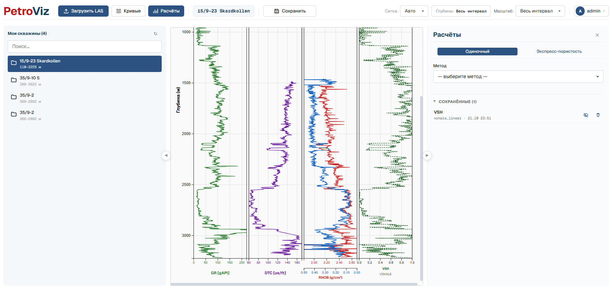

Экран разделён на три основные зоны:
*   **Левая панель:** Список доступных скважин и поиск по ним.
*   **Центральная часть:** Рабочая область (планшет с графиками).
*   **Правая панель:** Инструменты для петрофизических расчётов (открывается кнопкой «Расчёты»).

Вы можете изменять ширину панелей, перетаскивая разделители мышью, или сворачивать их в узкие полоски, чтобы освободить место для планшета.

### 4.2 Выбор кривых на планшете

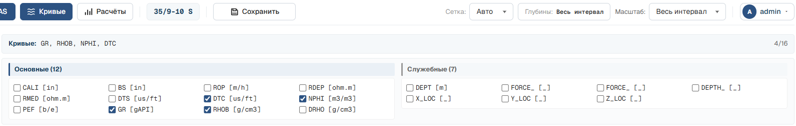

Нажмите кнопку **«Кривые»** в верхней панели, чтобы открыть список доступных данных.
*   Поставьте галочки напротив тех кривых, которые хотите видеть на экране (максимум 16 штук одновременно).
*   Кривые разделены на группы: «Основные» (гамма, плотность, сопротивление) и «Служебные» (каверномер, диаметр и т.д.).

### 4.3 Масштаб глубины
Выберите нужный масштаб в выпадающем списке в верхней панели:

| Масштаб | Приблизительный обзор | Когда использовать |
|---|---|---|
| **1:200** | ~72 метра на экран | Детальный анализ конкретного пласта |
| **1:500** | ~500 метров | Стандартный просмотр скважины |
| **1:1000** | ~1200 метров | Обзор средней скважины |
| **1:5000** | ~5000 метров | Быстрый просмотр очень глубоких скважин |
| **Весь интервал** | Вся скважина | Для печати или общего отчёта |

### 4.4 Сетка глубин и фильтрация
*   **Сетка:** Позволяет настроить шаг горизонтальных линий (например, каждые 10 или 25 метров).
*   **Глубины:** Нажмите кнопку «Глубины: Весь интервал», чтобы отфильтровать планшет. Введите кровлю и подошву (например, 2000 и 2400 метров) и нажмите «Применить».

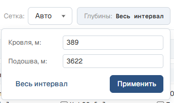

---

## 5. Петрофизические расчёты

Все расчёты производятся в правой панели. Есть два режима: **Одиночный** (тонкая настройка одного метода) и **Экспресс-пористость** (сравнение нескольких методов сразу).

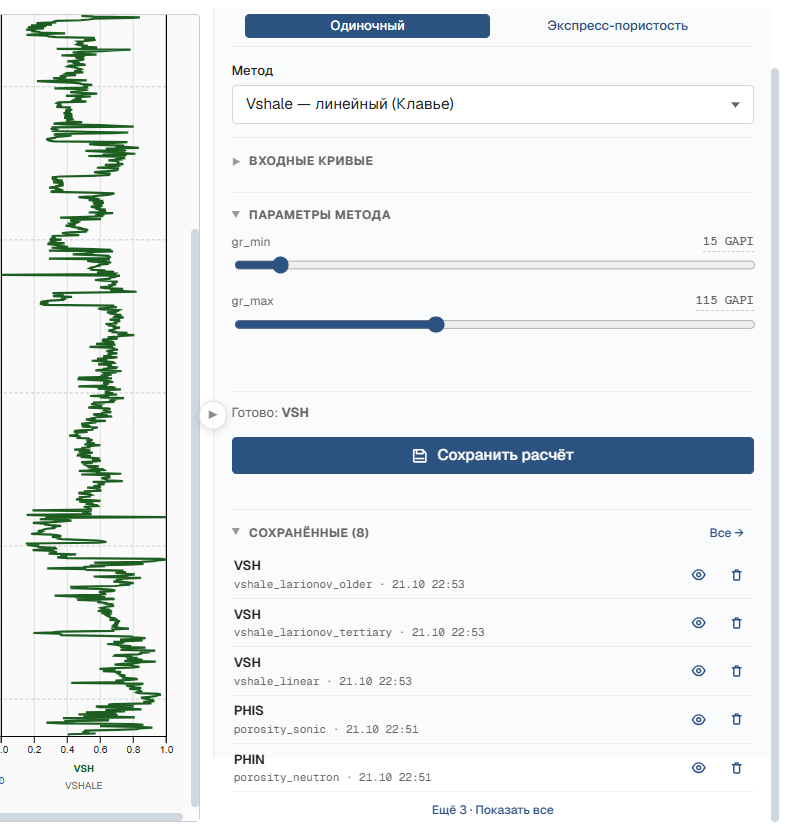

### 5.1 Общий принцип работы
1. Выберите метод из списка.
2. Система автоматически подберёт нужные кривые. Если нужной кривой нет, выберите её вручную.
3. Настройте параметры ползунками. Кривая на планшете будет перестраиваться мгновенно (в режиме реального времени).
4. Нажмите **«Сохранить расчёт»**, чтобы зафиксировать результат в базе данных.

### 5.2 Глинистость (Vshale)
Для расчёта используются данные гамма-каротажа (GR). Выберите один из пяти методов:
*   **Клавье (Линейный):** Стандарт для простых терригенных разрезов.
*   **Ларионов (третичные / древние):** Нелинейные формулы, учитывающие возраст пород.
*   **Штибер:** Для плотных, консолидированных песчаников.
*   **ГГКп-ННКт:** Использует разницу между нейтроном и плотностью. Работает там, где гамма-каротаж неинформативен (например, в углях).
*Настройка:* отрегулируйте ползунки `GR_min` и `GR_max` (значения для чистого песка и чистой глины соответственно).

### 5.3 Пористость (PHI)
Доступны 4 метода: по плотности (PHID), по нейтрону (PHIN), по акустике (PHIS, метод Уайли) и комбинированный метод (PHI_ND).

*   **Зоны флюидов:** В газовых интервалах плотность флюида сильно падает. Вы можете задать интервалы глубин и тип флюида (вода 1.0, нефть 0.8, газ 0.2). Система автоматически внесет поправку в формулу.

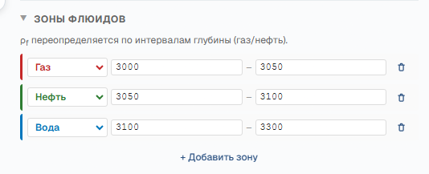

### 5.4 Водонасыщенность (Sw, Swi, R0)
> *Внимание: для этих методов необходимо предварительно сохранить расчёты Vshale и Пористости.*

*   **Swi (Связанная вода):** Доля неподвижной воды. Настраивается коэффициентами C1 и C2.
*   **Sw (Метод Арчи):** Требует выбора кривой сопротивления (УЭС). Настройте параметры `a, m, n` и `Rw` (сопротивление пластовой воды).
*   **R0 (Сопротивление водонасыщенной породы):** Строится пунктиром поверх кривых УЭС. **Как калибровать модель:** найдите чистый водяной пласт. Линия R0 должна совпасть с кривой УЭС (Rt). Если R0 выше — уменьшите `Rw` или `m`. Если ниже — увеличьте. Все изменения видны мгновенно.

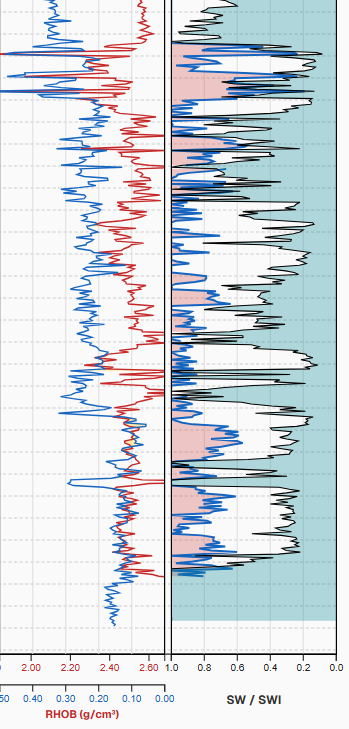

### 5.5 NTG и Проницаемость
*   **NTG (Песчанистость):** Задаются отсечки (cutoff) по глинистости, пористости и водонасыщенности. Всё, что проходит условия, помечается как коллектор (желтая заливка на треке).
*   **Проницаемость (Perm):** Рассчитывается по формуле Тимура-Коатса на основе пористости и связанной воды.

---

## 6. Сохранение и загрузка расчётов

> ⚠️ Для сохранения требуется роль **«Геофизик»**.

1. После настройки параметров нажмите **«💾 Сохранить расчёт»**.
2. Введите название (например, `VSH_Клавье`).

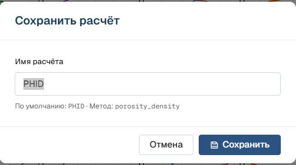

Сохранённые расчёты отображаются в списке внизу панели.

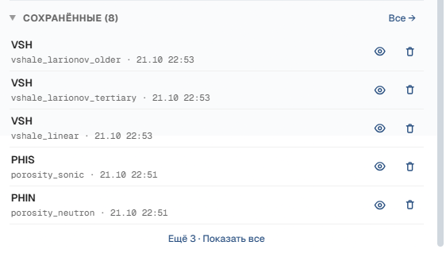

*   **Воспроизводимость:** В базе сохраняется не только результат, но и то, какие кривые и параметры использовались. Это позволяет вернуться к расчёту спустя время.
*   **Отображение:** Нажмите на иконку «Глаз» (👁), чтобы вывести сохраненную кривую на планшет. Она будет рисоваться **пунктирной линией**, чтобы отличать её от текущих настроек.

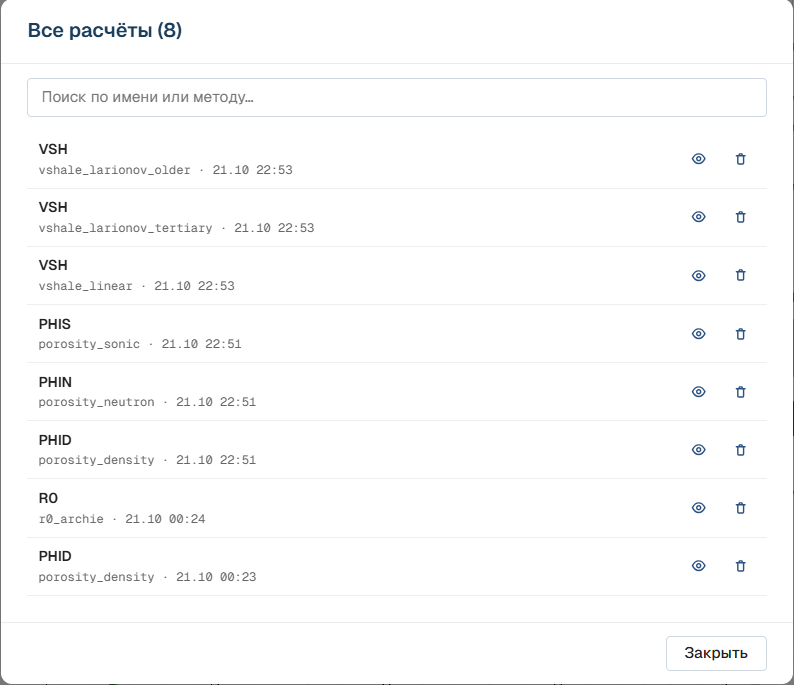

---

## 7. Экспорт данных

Нажмите кнопку **«⬇ Экспорт»** в верхней панели:

*   **LAS (.las):** Выгрузка исходных данных и сохранённых расчётов в стандартном формате для Techlog или Geolog.
*   **CSV (.csv):** Таблица для Excel/pandas (корректно открывается с кириллицей).
*   **PDF (.pdf):** Отчёт формируется в точности по тому виду, который вы видите на экране (с учётом фильтрации глубин). Включает шапку с названием скважины.

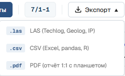
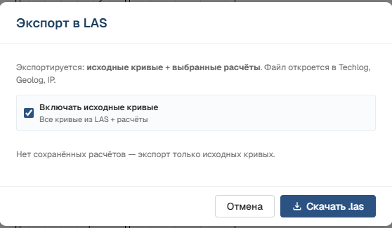

---

## 8. Сохранение вида планшета

Чтобы не настраивать всё заново при следующем входе:
1. Настройте кривые, масштаб и глубины.
2. Нажмите кнопку **«Сохранить»** (рядом с названием скважины).
3. При следующем открытии этой скважины планшет восстановит все настройки автоматически.

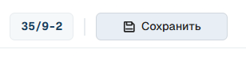

---

## 9. Администрирование

Доступно только для роли **«Администратор»**.

*   **Пользователи:** изменение ролей (например, повышение до «Геофизика»), блокировка доступа.

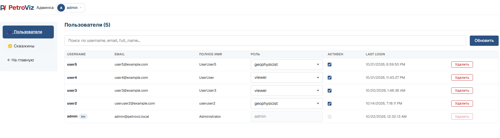

*   **Скважины:** просмотр всех данных и выдача прав доступа коллегам (уровни `read`, `write`, `owner`).

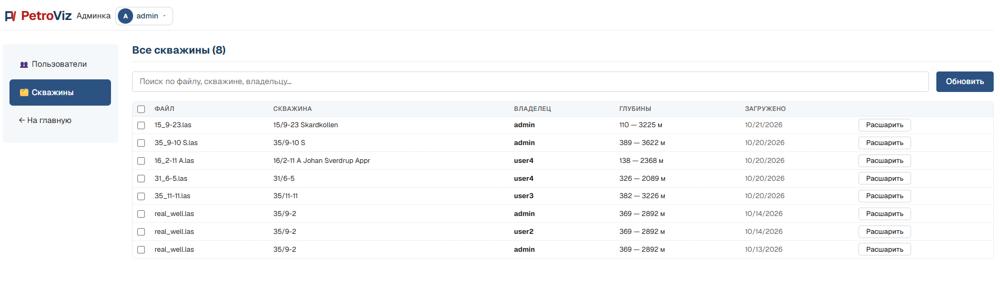

---

## 10. Типичные сценарии

### 10.1 Быстрая оценка (Экспресс-пористость)
1. Загрузите LAS.
2. В панели расчётов выберите вкладку **«Экспресс-пористость»**.
3. Система посчитает 4 вида пористости. На вкладке «Кросс-плоты» оцените, насколько методы согласуются между собой (например, разница укажет на газ).

### 10.2 Полноценная интерпретация
1. Настройте и сохраните **Vshale**.
2. Настройте и сохраните **Пористость**.
3. Откройте **Арчи (Sw)**, выберите сохранённые Vsh и PHI в качестве источников. Откалибруйте `Rw` по кривой R0.
4. Сохраните **Swi**.
5. Настройте и сохраните **NTG** и **Проницаемость**.

---

## 11. Частые вопросы и решение проблем

**— Почему кнопка «Сохранить расчёт» серая?**
У вашей учетной записи роль «Наблюдатель». Попросите администратора выдать права «Геофизика».

**— Что делать, если система пишет «Не найдена кривая для...»?**
В вашем LAS-файле нет кривой с ожидаемым названием. В панели расчётов в блоке «Входные кривые» выберите нужную кривую из выпадающего списка вручную.

**— Кривые «рваные», с резкими горизонтальными выбросами. Это ошибка?**
Скорее всего, это физика данных. Кривые сопротивления (Rt) шумные по своей природе, и методы, основанные на них (Sw, R0), наследуют этот шум. Уменьшите масштаб (перейдите на 1:500), чтобы визуально сгладить картину.

**— Масштаб 1:2000 и 1:5000 выглядят одинаково.**
Если скважина короткая (менее 800 метров), обе шкалы упираются в минимальную высоту отрисовки на экране. На длинных скважинах разница будет заметна.

**— Расчет VSH не повторяет кривую GR, а выглядит зеркально.**
Проверьте параметры `GR_min` и `GR_max` — возможно, они перепутаны местами. Чистый песок должен иметь низкий GR, а глина — высокий.

**— Как сбросить пароль?**
Автоматического сброса через email нет. Обратитесь к администратору платформы.

---

## 12. Приложение: формулы и параметры

### 12.1 Глинистость (Vshale)
*   **Клавье:** `Vsh = (GR - GR_min) / (GR_max - GR_min)`
*   **Ларионов (третичные):** `Vsh = 0.083 × (2^(3.7·IGR) - 1)`
*   **Ларионов (древние):** `Vsh = 0.33 × (2^(2·IGR) - 1)`
*   **Штибер:** `Vsh = 0.5·IGR / (1.5 - IGR)`

### 12.2 Пористость (PHI)
*   **По плотности:** `(ρ_матрицы - ρ_породы) / (ρ_матрицы - ρ_флюида)`
*   **По акустике (Уайли):** `(DT - DT_матрицы) / (DT_флюида - DT_матрицы)`

### 12.3 Водонасыщенность
*   **Связанная вода (Swi):** `(C1 + C2 × Vsh) / PHI`
*   **Арчи (Sw):** `((a × Rw) / (PHI^m × Rt))^(1/n)`
*   **Сопротивление водонасыщенной породы (R0):** `(a × Rw) / (PHI^m)`

### 12.4 Проницаемость (Тимур-Коатс)
*   `K = (C × PHI^a) / Swi^b` (в миллидарси, мД)

### 12.5 Стандартные значения по умолчанию
| Параметр | Значение |
|---|---|
| GR_min / GR_max | 15 / 120 GAPI |
| Плотность матрицы (песчаник) | 2.65 г/см³ |
| Плотность воды / нефти / газа | 1.0 / 0.8 / 0.2 г/см³ |
| Коэффициенты Арчи (a / m / n) | 1.0 / 2.0 / 2.0 |
| Сопротивление воды (Rw) | 0.1 Ом·м |
| Коэффициенты Тимура-Коатса (C / a / b) | 10000 / 4.5 / 2.0 |

---
*© 2026 PetroViz. Все права защищены.*
